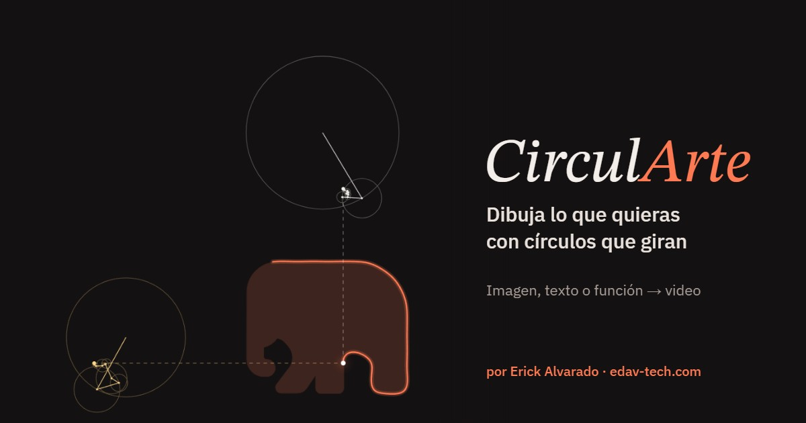

# CirculArte

Dibuja lo que quieras con círculos que giran. Sube una imagen, escribe un texto o inventa una función, y mira cómo una serie de Fourier la traza sola. Cada reproducción se graba como video listo para TikTok, Reels o Facebook.



Dos cadenas de círculos (una para `x(t)`, otra para `y(t)`) trazan la figura mientras el número de términos sube (N = 1, 3, 6 … 200) y el error baja. Al final queda solo la imagen, con las fórmulas de la serie.

## Uso

Es un sitio estático, sin build: `index.html` más el motor en `src/engine.js` (un módulo ES). Sírvelo con cualquier servidor estático, por ejemplo `npx serve .`, y ábrelo en Chrome o Edge. Por ser un módulo, abrir `index.html` con doble clic (`file://`) ya no funciona. En Vercel se publica tal cual, sin build: `vercel.json` instala solo las dependencias de las funciones de `api/` (`@vercel/blob`); las del render (canvas, ffmpeg, fuentes, OpenAI) son `devDependencies` y Vercel las omite. Sin las variables de entorno de TikTok, el sitio funciona igual y simplemente no muestra el botón «Publicar en TikTok».

- **Funciones**: figuras listas en cuatro grupos: Amor (corazón, LOVE, amor, te amo), Animales (elefante, pulpo, dragón, araña, escorpión, jirafa…), Cosas (guitarra, rueda de la fortuna, bicicleta, Estatua de la Libertad…) y Matemáticas (copo de Koch, π, espirógrafo, rosas…). **🎲 Figura compleja al azar** elige entre las que tienen más detalle o inventa una curva compleja, lo mismo que la publicación automática.
- **Modo suspenso** (en Animación): la figura no se ve hasta el final. Apaga la imagen de guía, deja solo textos de arriba que no dicen qué es, y al publicar en TikTok propone una descripción que invita a adivinar y usa de portada un cuadro a mitad del dibujo. **Máximo detalle** sube los términos hasta N = 500.
- **Pelotas**: pelotas que rebotan dentro de un círculo, con una nota en cada rebote (sintetizada aquí, sin música con derechos). Cuatro variantes: *Crece* (una pelota que se agranda con cada rebote hasta llenar el círculo), *Se multiplica* (cada rebote suelta otra pelota), *Escapar* (el círculo gira con un hueco y cada pelota que sale suelta dos más) y *Líneas* (cada rebote deja una línea de colores hasta el centro y se va formando un dibujo). No muestra contadores: arriba va una pregunta («¿Cuántas logran escapar?») y abajo una invitación a comentar («Escribe tu apuesta antes del final 👇»), elegidas al azar entre varias. «🎲 Nueva corrida» genera otra; la grabación incluye el sonido.
- **Juegos de física** (en la misma pestaña): *Embudos* (caja con niveles en V; cada pelota que sale por abajo suelta varias más), *Anillos* (círculos uno dentro de otro que giran con un hueco; la pelota tiene que escapar de todos), *Plinko* (pelotas que caen entre clavos y se apilan en casillas) *Carrera* (pelotas de colores bajan por rampas y clavos; al final se anuncia la ganadora), *Países* (la misma carrera con banderas; Honduras corre en la mitad), *Muros* (anillos partidos en pedazos que se agrietan con cada choque hasta que la pelota se abre paso) y *Batalla* (dos pelotas con armas que giran, con barras de vida; gana la que deja a la otra en cero). También con una nota en cada choque.
- **Melodías**: 7 de cada 10 corridas tocan, nota por choque, una melodía conocida de dominio público (*Para Elisa*, *Himno a la alegría*, *Estrellita*, *Canon de Pachelbel*, *Canción de cuna de Brahms*, *La cucaracha*); en algunas el texto de arriba pregunta «¿Reconoces la canción?». En Node: `node scripts/bounce.mjs --mode batalla --melody alegria` (o `--melody none`).
- **Imagen**: elige, arrastra o pega (Ctrl+V) una imagen. Modo *Silueta* para logos, *Bordes* para fotos.
- **Texto**: cualquier palabra, símbolo o emoji. Los emoji se vuelven silueta plana. Seis estilos para nombres: *Clásico*; *Espejo* (el nombre de lado pegado a su reflejo forma una criatura y al final se escribe abajo); *Mandala* (el nombre repetido como rayos alrededor de un anillo); *Hilos* (string art: clavos en el borde de cada letra y un hilo que la cruza de clavo en clavo); *Anillos* (el nombre partido en anillos que giran como un candado hasta alinearse); y *Costura* (una aguja lo borda puntada por puntada en un bastidor). Los tres últimos tienen su propia animación con una melodía. Para una pareja escribe «Ana & Luis». «Imagen de guía» también vale para ellos: en Hilos muestra antes los clavos de las letras y en Costura el calco a lápiz (en 0 el nombre no se adelanta).
- **Futbolistas** (workflow «Futbolistas a TikTok», dos al día): 25 caras en stencil y 25 celebraciones y goles icónicos (el «Siuuu», la meditación de Haaland, la chilena de Cristiano, la mano de Dios…), dibujados con círculos; arriba preguntan «¿Quién es?» o «¿Quién celebraba así?» y al final se escribe el nombre. La lista está en [data/famosos.json](data/famosos.json) y las siluetas limpias en `assets/famosos/`. Se generaron con la API de imágenes de OpenAI (≈ $0.014 cada una): `node --env-file=../minidramas/.env scripts/famosos-imagenes.mjs` genera las que falten.
- **Agregar tus propias siluetas o escudos**: pon las imágenes en `siluetas/logo/`, `siluetas/cara/`, `siluetas/pose/` o `siluetas/gol/`, con el nombre que debe salir al final (por ejemplo `siluetas/logo/Real Madrid.png`), y corre `npm run silueta`. Detecta el fondo, ajusta el umbral, quita manchitas, recorta, las agrega a `data/famosos.json` y deja una vista previa en `out/siluetas/`. Si sale al revés, `npm run silueta -- --file escudo.png --nombre "Real Madrid" --tipo logo --invert`. Después sube los cambios con git para que el workflow las use.
- **Portada**: los videos de nombres, parejas y futbolistas empiezan con 0,6 s de portada (el dibujo avanzado con una pregunta grande, como «¿QUÉ NOMBRE ES? 👀» o «¿QUIÉN ES? ⚽»), porque TikTok usa el primer cuadro como vista previa en el perfil. Los dibujos con círculos empiezan en N = 8 en vez de N = 1. En Node: `--cover "texto"` en `render.mjs` y `arte.mjs` (`--still cover` para ver solo la portada).
- **Curiosidades y noticias en imagen** (sin IA): workflows «Curiosidades a Facebook» (8 al día, publicadas directo en la página) y «Curiosidades a TikTok» (2 al día, foto en borrador). Cuatro formatos al azar: «¿Sabías que…?» (dato real), «¿Verdadero o falso?» (a veces el dato es falso), «¿Cuál es falso?» (tres datos, uno falso) y retos de matemáticas con tres opciones; la respuesta siempre va en la descripción, debajo de «Ver más». La base son unas 870 curiosidades en `data/curiosidades/*.json` (750 datos de animales, cuerpo humano, ciencia, geografía, historia, comida, deportes, tecnología y videojuegos, inventos y matemáticas, más 119 retos; cada una con su versión falsa y la explicación). Una de cada 4 publicaciones de Facebook es una noticia reciente (videojuegos, fútbol o ciencia) tomada del RSS de Eurogamer, VidaExtra, Marca, Xataka Ciencia o Muy Interesante, con el titular, el medio y el enlace (`scripts/lib/noticias.mjs`). Imágenes: `scripts/lib/tarjetas.mjs` (texto, emoji de Noto Color Emoji como ícono, colores por tema y la marca Potter Play). A mano: `node scripts/curiosidades.mjs --dry-run --formato vf` deja la imagen y el texto en `out/`.
- **Facebook**: si existen los secretos `FB_PAGE_ID` y `FB_PAGE_TOKEN`, cada video de los workflows se publica además como **Reel público en la página**, con la misma descripción. A Facebook va con melodía (hilos, anillos, costura); TikTok recibe una copia muda. Al lanzar a mano, «facebook: si | no | borrador». En Node: `node scripts/facebook.mjs --video out/x.mp4`. Para sacar el token: crea una app en developers.facebook.com (tipo «Business»), dale los permisos `pages_show_list`, `pages_read_engagement`, `pages_manage_posts` y `publish_video`, genera en el Graph API Explorer un token de usuario con esos permisos, extiéndelo en el Access Token Debugger («Extend Access Token») y con él pide `GET /me/accounts`: el `access_token` de tu página (no vence) es `FB_PAGE_TOKEN` y su `id` es `FB_PAGE_ID`. La app tiene que estar en modo Live para que los Reels sean públicos (la «CirculArte Reels» lo está desde el 2026-10-30).
- **Retos visuales en imagen** (`scripts/lib/retos-visuales.mjs`, sin IA, desde el 2026-11-01): al estilo de las publicaciones de acertijos que más comentarios juntan en Facebook. Fondo claro, pregunta grande con palabras en rojo y un reto generado al azar: número duplicado, nombre de N letras que termine o empiece en…, letra o emoji escondido, fracción del círculo pintada y operación con trampa de orden. Son 2 de cada 3 imágenes de «Curiosidades a Facebook» (10 al día) y también van a TikTok e Instagram. A mano: `node scripts/curiosidades.mjs --dry-run --visual nombre`. Las descripciones no piden «comenta» ni «etiqueta» (Meta baja el alcance del engagement bait): hacen la pregunta y esconden la respuesta debajo de «Ver más».
- **Respuestas a comentarios** (`comentarios.yml`, cada hora de 7:47 a 23:47): cada reto o quiz publicado guarda su respuesta correcta (`scripts/lib/respuestas.mjs`, 7 días en `data/respuestas.json`). `scripts/comentarios.mjs` lee los comentarios nuevos de los últimos 3 días en Facebook e Instagram y contesta «¡Correcto! ✅» (con «me gusta» en Facebook) a quien acierta, un ánimo a quien falla y su puntaje en los quiz; en los retos de nombres solo felicita a quien da uno que cumple. Lo que no parece una respuesta no se contesta. Máximo 25 respuestas por corrida, con pausas. Necesita en el token `pages_read_user_content`, `pages_manage_engagement` e `instagram_manage_comments`.
- **Estadísticas** (`estadisticas.yml`, a mano): vistas, reacciones, comentarios y compartidos por formato y por hora, de Facebook e Instagram. Las vistas de Instagram necesitan además el permiso `instagram_manage_insights`. Primer informe (2026-11-01): banderas 759 vistas promedio, quiz 284, top 10 y nombres unos 140, futbolistas 5 e imágenes de curiosidades 5 a 26. Por eso nombres y futbolistas quedaron solo en TikTok y `facebook-reels.yml` está desactivado.
- **Instagram** (`scripts/instagram.mjs`): todo lo que se publica en la página de Facebook (Reels, historias e imágenes de curiosidades) sale también en la cuenta profesional de Instagram vinculada a la página (@potter.play). Usa el mismo `FB_PAGE_TOKEN`, que necesita además `instagram_basic` e `instagram_content_publish` (caso de uso «Administrar mensajes y contenido en Instagram» de la app, y la cuenta de Instagram asignada al usuario del sistema). Instagram toma el archivo de una URL pública (el almacén Blob); las imágenes van en JPEG. Si falta el permiso o la cuenta, se salta sin fallar. Límite: 100 publicaciones por día. Para no publicar ahí: `--instagram no`. Comprobar: `node --env-file=.env scripts/instagram.mjs`.
- **Quiz y curiosidades en video** (`curiosidades-reels.yml`, sin IA): 6 Reels al día de 50 a 59 s para Facebook, también como historia (7:57, 12:57, 13:57, 18:57, 19:57 y 21:57). Rotan «10 cosas que no sabías hace 1 minuto» (10 datos de `data/curiosidades/`, de un tema o mezclados), «5 preguntas: ¿cuántas aciertas?» (verdadero o falso, un reto y un cálculo mental generado, con cuenta atrás de 5 a 7 s) y «Adivina las 10 banderas» (de fácil a difícil, opciones del mismo continente; nombres en español con `Intl.DisplayNames`). Todo se dibuja con canvas (`scripts/lib/quiz-video.mjs`), con tic-tac, efectos y una melodía de dominio público sintetizados, normalizados a −16 LUFS. Las respuestas van en la descripción, debajo de «Ver más». A mano: `node scripts/curiosidades-video.mjs --dry-run --formato quiz` (o `top10`, `banderas`; `--still 5` saca un cuadro en PNG). Historial para no repetir: `data/curiosidades-video-historial.json`.
- **Reels a Facebook** (`facebook-reels.yml`): 8 Reels más al día solo para la página, 6 de nombres y parejas (8:27, 12:27, 18:27, 20:27, 21:27 y 22:27, hora de Honduras) y 2 de futbolistas (13:37 y 19:37), con sonido. Cada uno sale también como **historia** de la página (`daily.mjs --historia`; las historias admiten hasta 60 s). No van a TikTok ni mandan el aviso por correo (`aviso: false`).
- **Sin sonido**: junto a «Grabar video», graba sin las notas (para ponerle en TikTok una canción del momento). En la publicación automática los videos salen sin sonido salvo que al lanzarla a mano elijas «sonido: con»; en Node, `--mute` en `bounce.mjs`, `arte.mjs` y `daily.mjs`.
- **Inventar**: genera funciones aleatorias, edítalas (`16 sin(t)^3`), mútalas y guarda tus favoritas.
- **Videos**: con «Grabar video» marcado, cada reproducción queda en *Mis videos* lista para guardar (MP4 o WebM según el navegador). Formatos 9:16, 1:1 y 16:9 en 720p o 1080p, con texto gancho arriba, rótulos a elegir y firma opcional.

Mantén la pestaña visible mientras graba; si queda oculta, el video sale entrecortado.

## Cómo funciona

1. La imagen se convierte en una máscara y se extraen sus contornos con *marching squares*.
2. Los contornos se unen en un solo recorrido cerrado y se remuestrean a 2048 puntos por longitud de arco.
3. Se calcula la serie de Fourier de `x(t)` y `y(t)` (hasta 500 términos). El error mostrado es la energía que falta según Parseval.
4. Cada término es un círculo de radio `√(a_k² + b_k²)` que gira a velocidad `k`.
5. El lienzo se graba con `MediaRecorder`. Las visitas se miden con Vercel Web Analytics.

## Videos automáticos (Node)

Los mismos videos que graba la web, pero renderizados en Node cuadro por cuadro, sin navegador: mismo motor (`src/engine.js`), mismas fuentes y mismo resultado en cada ejecución. Pensado para publicar en TikTok de forma automática.

Requisitos: Node 20 o más reciente. `ffmpeg` viene incluido (`ffmpeg-static`).

```bash
npm install
npm run fonts                                   # una vez: descarga Noto Color Emoji (25 MB) a assets/fonts/
npm run render -- --preset Violín --lang en     # → out/circularte-violin-en.mp4 + .json
```

| Script | Qué hace |
|---|---|
| `npm run render -- …` | Renderiza un MP4 H.264 (High, yuv420p, 1080×1920, 30 fps, pista de audio AAC en silencio) |
| `npm run pick` | Elige la próxima figura evitando las 12 más recientes y sin repetir grupo seguido; la anota en `data/history.json` (`--dry-run` para no anotar) |
| `npm run caption -- --meta out/<video>.json` | Escribe la descripción y los hashtags del post con plantillas propias (`--no-spoiler` para no nombrar la figura) |
| `npm run daily -- --lang es` | Encadena pick → render → caption en modo suspenso y deja el texto del post en el `.json` del video; con `--publish direct` (público por defecto) o `draft` también lo sube a TikTok |
| `npm run tiktok:connect` | Conecta tu cuenta de TikTok (una vez; `-- --status` muestra la cuenta y cuándo vence) |
| `npm run publish -- --video out/<video>.mp4 --mode draft` | Sube el video a TikTok como borrador (`--mode direct --privacy PUBLIC_TO_EVERYONE` lo publica) |

Opciones de `render` (`npm run render -- --help` las lista todas):

- Qué dibujar: `--preset <nombre>` (cualquier preset de la web, en español o inglés: `Corazón`, `Heart`, `Violín`…), `--random <tipo>` (`any`, `fourier`, `polar`, `rosa`, `spiro`, `lissa`, `super`, `simetria`) con `--seed <n>` para repetirla, o `--text <texto>` con `--font cursiva|elegante|bloque|clasica|emoji`.
- Cómo se ve: `--labels full|n|top`, `--style xy|z`, `--fps 30|60`, `--format 9:16|1:1|16:9`, `--quality 1080|720`, `--rev`, `--nseq`, `--accent`, `--guide 0-60` (opacidad de la figura de guía mientras dibuja; `0` = no se ve hasta el final), `--no-reveal`, `--no-formulas`, `--signature` (la firma CirculArte + edav-tech.com va apagada por defecto: las guías de TikTok no aceptan marcas, logos ni enlaces dentro del video).
- Texto gancho de arriba: `--caption auto` (por defecto, elige uno de los de la web según `--lang`; con `--no-spoiler`, solo los que no nombran la figura), `--caption none` o `--caption "tu texto"`.
- `--lang es|en` cambia el texto gancho y el nombre del archivo. `--out` cambia la ruta. `--still <segundos>` guarda un PNG de ese instante en lugar del video, útil para revisar el encuadre.

Junto a cada MP4 queda un `.json` con la figura, la semilla, la duración y el texto gancho; `caption` agrega ahí el texto del post y `publish` lo usa como descripción y anota el resultado de cada subida.

**Emoji.** Los presets de animales y cosas son siluetas de emoji, así que el render necesita una fuente de emoji a color. `npm run fonts` descarga Noto Color Emoji desde google/fonts (licencia OFL; no se sube al repo) y con ella el resultado es idéntico en Windows, macOS y Linux. Sin ella se usa la del sistema (Segoe UI Emoji en Windows, Apple Color Emoji en macOS); en un Linux sin fuentes de emoji esos presets fallan con un aviso y `pick` los salta. También puedes apuntar a otra fuente con `CIRCULARTE_EMOJI_FONT=/ruta/fuente.ttf`.

**Descripciones.** `caption` arma la descripción y los hashtags con plantillas propias, sin IA ni APIs de pago: la misma figura y semilla dan siempre el mismo texto. Con `--no-spoiler` no dice qué figura es (invita a adivinar en los comentarios).

**Sin IA.** Todo el video sale del proyecto: las figuras son fórmulas, texto o siluetas de emoji de la fuente Noto Color Emoji, y el dibujo es la serie de Fourier calculada aquí. Por eso las publicaciones no llevan la etiqueta de contenido generado por IA.

## Publicar en TikTok

Usa solo la API oficial de TikTok (Login Kit + Content Posting API); nada de bots ni scraping. Necesitas en `.env` las credenciales de la app (`TIKTOK_CLIENT_KEY`, `TIKTOK_CLIENT_SECRET`, `TIKTOK_REDIRECT_URI`) con los permisos `user.info.basic`, `video.upload` y `video.publish`. En el sandbox, tu cuenta tiene que estar agregada como *Target User*.

1. `npm run tiktok:connect` imprime la URL de autorización. Ábrela, autoriza, y la página `tiktok-callback.html` te muestra un código y un *state*: pégalos en la terminal. Los tokens quedan en `data/tiktok-token.json` (en `.gitignore`); el de acceso dura 24 h y se renueva solo con el de refresco, que dura 365 días.
2. `npm run publish -- --video out/<video>.mp4 --mode draft` lo manda a tu bandeja de TikTok como borrador: abres la notificación en la app, pegas la descripción que imprime el script y publicas.
3. `--mode direct` lo publica directo con la descripción del `.json` y la privacidad de `--privacy` (`SELF_ONLY` por defecto; `PUBLIC_TO_EVERYONE` para público). La app está aprobada en Production desde el 23-10-2026, así que ya admite público.

Límites de la API que respeta el script: video de hasta 4 GB, subido en trozos de 5 a 64 MB (uno solo si pesa hasta 64 MB); el enlace de subida dura una hora; 6 inicios de subida por minuto; 30 consultas de estado por minuto; como mucho 5 borradores pendientes cada 24 horas. TikTok acepta MP4/MOV/WebM, H.264, de 23 a 60 fps.

## Publicar desde la web (producción)

Cada video de «Mis videos» tiene un botón **Publicar en TikTok** que publica directo, en un paso, en la cuenta que el visitante conecte. La pantalla cumple las [Content Sharing Guidelines](https://developers.tiktok.com/doc/content-sharing-guidelines) de TikTok, que se revisan en la auditoría: muestra la cuenta, una vista previa, la descripción editable, la privacidad elegida a mano y sin valor por defecto, las interacciones apagadas por defecto (y bloqueadas si la cuenta las desactivó), la divulgación de contenido comercial con sus etiquetas y la declaración de consentimiento.

Cómo funciona: la conexión con TikTok se abre en una ventana emergente (así no se pierden los videos grabados), `tiktok-callback.html` canjea el código en `/api/tiktok-session` y la sesión queda en una cookie cifrada, sin base de datos. El navegador no puede subir a TikTok directamente (su servidor de subida no admite CORS), así que sube el video a **Vercel Blob**, TikTok lo descarga desde `https://circularte.edav-tech.com/media/…` (`PULL_FROM_URL`, dominio verificado) y la copia se borra al terminar o a las 24 horas.

| Función | Para qué |
|---|---|
| `api/tiktok-config` | Si la publicación está configurada y hay cuenta conectada |
| `api/tiktok-login`, `api/tiktok-session`, `api/tiktok-logout` | Conectar (OAuth con *state*) y desconectar (revoca el token) |
| `api/tiktok-creator` | Nickname, privacidad permitida, interacciones y duración máxima |
| `api/tiktok-upload` | Token de subida directa a Blob (solo con sesión; solo videos, máx. 300 MB) |
| `api/tiktok-publish`, `api/tiktok-status` | Publicar (revalida todo contra `creator_info`) y consultar el estado |

### Configurar en Vercel (una vez)

1. **Almacén Blob:** en el proyecto de Vercel → *Storage* → *Create* → *Blob*, con acceso **Public**, conectado a *Production* (y *Preview* si quieres probar ahí). Esto crea `BLOB_READ_WRITE_TOKEN`.
2. **Proxy de `/media`:** en `vercel.json`, reemplaza `BLOB_STORE_HOST` por el identificador de tu almacén: es la primera parte del dominio de cualquier archivo subido (`<identificador>.public.blob.vercel-storage.com`).
3. **Variables de entorno** (*Settings* → *Environment Variables*, en *Production*):
   - `TIKTOK_CLIENT_KEY`, `TIKTOK_CLIENT_SECRET`: las credenciales de la app (sandbox para probar, producción cuando la aprueben).
   - `TIKTOK_REDIRECT_URI`: `https://circularte.edav-tech.com/tiktok-callback.html`
   - `SESSION_SECRET`: una cadena aleatoria larga para cifrar las cookies, por ejemplo la salida de `node -e "console.log(require('crypto').randomBytes(32).toString('base64url'))"`.
   - Opcional: `PUBLIC_MEDIA_BASE` si el sitio vive en otro dominio (por defecto `https://circularte.edav-tech.com/media/`).
4. **TikTok Developers:** en la app, el dominio `circularte.edav-tech.com` tiene que estar verificado como *URL property* (para `PULL_FROM_URL`) y el redirect URI registrado en Login Kit.

### Auditoría de TikTok

La app ya pasó la revisión (Production en vivo desde el 23-10-2026). Antes, sin auditoría, todo lo que se publicaba por la API quedaba privado («Solo yo»), la cuenta tenía que ser privada y como mucho 5 usuarios distintos podían publicar cada día. La revisión se pidió en el portal de TikTok Developers (app *Circularte* → *Production* → enviar a revisión con Login Kit y Content Posting API con *Direct Post*), con un video que muestre el flujo completo en la web: grabar un video, «Publicar en TikTok», conectar la cuenta, elegir la privacidad y publicar. Ojo: TikTok aprueba esta API para apps abiertas al público, no para herramientas que solo suben a las cuentas propias; por eso la publicación directa vive en la web, donde cualquiera publica sus propios videos.

## Publicación diaria (GitHub Actions)

`.github/workflows/daily.yml` genera un video **cada 4 horas** (en Honduras: 18:17, 22:17, 2:17, 6:17, 10:17 y 14:17; GitHub puede atrasar las corridas programadas varias horas) y lo manda a tu bandeja de TikTok como **borrador**; la descripción con hashtags queda en el resumen de la corrida (*Actions* → la corrida → *Summary*) para copiarla y pegarla en la app. Va en **modo suspenso**: elige solo figuras complejas (sin los presets marcados `simple`), no muestra la figura de guía mientras dibuja, ni el texto gancho ni la descripción dicen qué es, y la portada es un cuadro a mitad del dibujo. La figura completa aparece solo al final. TikTok admite como mucho 5 borradores pendientes cada 24 horas por cuenta: publica los que lleguen o el sexto del día fallará.


**Workflows (desde el 2026-10-27).** `nombres.yml` («Nombres a TikTok»): nombres y parejas solo con los estilos nuevos (espejo, mandala, hilos, anillos, costura), 3 al día (7:17, 13:17 y 19:17, hora de Honduras). `famosos.yml` («Futbolistas a TikTok»): 2 al día (10:47 y 16:47). Todos van como Reel a Facebook, pero a TikTok solo 2 nombres (7:17 y 13:17) y 1 futbolista (10:47): con las 2 fotos de curiosidades son 5, el máximo de borradores pendientes que TikTok acepta cada 24 h (desde el 2026-10-30). Las corridas de las 19:17 y 16:47 llevan `publish: none` y sonido (se distinguen por `github.event.schedule`). `daily.yml` es la base que reutilizan (mismo token e historial, nunca corren a la vez) y ya no corre solo: se lanza a mano con cualquier tipo de video (dibujos, nombres, famosos…), un campo «figura» para una figura concreta y «sonido». `fisica.yml` está desactivado. Juntos mandan 12 borradores al día: cuando TikTok ya tiene 5 pendientes, la corrida no falla, solo avisa y deja el video como artefacto para descargarlo.

**Aviso por WhatsApp** (opcional, gratis con [CallMeBot](https://www.callmebot.com/blog/free-api-whatsapp-messages/)): al terminar cada corrida manda un mensaje con el estado, la figura, la descripción para pegar y el enlace. Para activarlo: sigue los pasos de esa página (agregar su número de WhatsApp, que aparece ahí, y mandarle «I allow callmebot to send me messages»), y guarda en GitHub los secretos `CALLMEBOT_PHONE` (tu número con código de país, por ejemplo +504…) y `CALLMEBOT_APIKEY` (la clave que te responde). Sin esos secretos el paso se salta. Por **correo**: GitHub → Settings → Notifications → Actions, desmarca «Only notify for failed workflows».
**Biblioteca** ([data/biblioteca.json](data/biblioteca.json)): de ahí elige la publicación automática, además de los presets sin emoji y las curvas inventadas. Tiene **221 nombres latinos comunes** y **100 parejas** («Ana & Luis», escritas apiladas en tres líneas) en letra cursiva, y **100 figuras** de emoji revisadas una por una para que la silueta se reconozca. En los dibujos, el reparto es 50 % nombres, 17 % parejas, 20 % figuras y 13 % curvas inventadas (`SHARES` en `scripts/pick.mjs`); cada nombre sale con uno de los seis estilos sin repetir el anterior, y las parejas en clásico, anillos o costura (`NAME_STYLES_BY_CAT`). Hilos, anillos y costura se hacen con `scripts/arte.mjs` (por ejemplo `node scripts/arte.mjs --mode costura --text Andrea`), y no repite nada de las últimas 60 corridas (unos 10 días). Para agregar más, edita el JSON; los nombres deben usar solo letras del alfabeto latino (con tildes y ñ), porque la letra cursiva no trae otros símbolos.

Va en borrador porque publicar directo necesita la auditoría de Direct Post de TikTok (aparte de la revisión de la app); sin ella da `403 unaudited_client_can_only_post_to_private_accounts`. Cómo pedirla: [docs/AUDITORIA-DIRECT-POST.md](docs/AUDITORIA-DIRECT-POST.md). Cuando la aprueben, se puede pasar a directo cambiando `draft` por `direct` en `daily.yml` (y elegir la privacidad). Ojo: las reglas de TikTok para desarrolladores no aceptan herramientas que suben contenido a las propias cuentas, y TikTok podría quitarle el permiso a la app (con eso dejaría de funcionar también la web).

También se puede lanzar a mano desde *Actions* → *Video diario a TikTok* → *Run workflow* (eliges idioma, `direct`/`draft`/`none` y la privacidad), y cada corrida deja el video como artefacto durante 7 días. En local: `npm run daily -- --publish direct` (o `--spoiler` para el modo anterior, con guía y nombre).

Secretos del repositorio (*Settings* → *Secrets and variables* → *Actions*):

| Secreto | Valor |
|---|---|
| `TIKTOK_CLIENT_KEY`, `TIKTOK_CLIENT_SECRET`, `TIKTOK_REDIRECT_URI` | Los mismos de tu `.env` |
| `TIKTOK_TOKEN_SEED` | El contenido completo de `data/tiktok-token.json` después de `npm run tiktok:connect` (solo se usa en la primera corrida) |
| `STATE_KEY` | Una cadena aleatoria larga: cifra el token y el historial que el flujo guarda en la caché de Actions entre corridas |

Para cargarlos sin copiarlos a mano: `powershell -ExecutionPolicy Bypass -File scripts/secrets-to-clipboard.ps1` pone cada valor en el portapapeles (de `.env` y del token), tú lo pegas en GitHub y en la terminal solo presionas Enter.

El token se renueva solo y el nuevo se guarda cifrado en la caché. Si el flujo deja de correr más de 7 días, GitHub borra la caché: vuelve a conectar con `npm run tiktok:connect` y actualiza `TIKTOK_TOKEN_SEED`.

**PowerShell.** Windows PowerShell 5.1 se come el `--` de `npm run render -- --preset …`. Usa `npm.cmd run render -- …` o directamente `node scripts/render.mjs --preset …`.

## Créditos

Creado por **Erick Alvarado**, Senior Full Stack Dev · Tech Lead.

- Sitio: [edav-tech.com](https://edav-tech.com/)
- ¿Quieres una app a la medida? [Iniciar un proyecto](https://www.edav-tech.com/start-project)
- [GitHub](https://github.com/elporter17) · [LinkedIn](https://www.linkedin.com/in/edav/)
